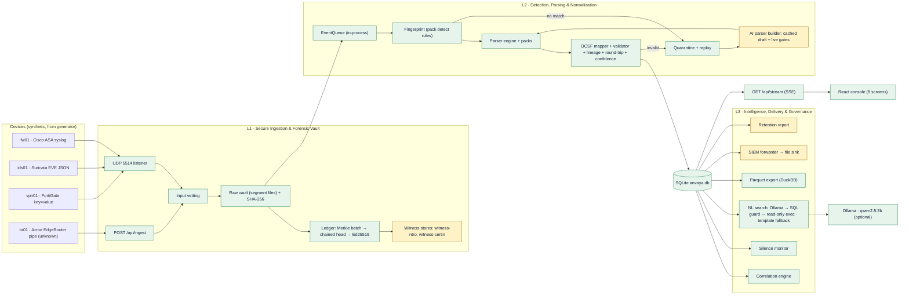

# TRD.md: ANVAYA Technical Requirements (Demo-Video MVP)

## 1. Document metadata

| Attribute | Detail |
|---|---|
| Document | ANVAYA: Technical Requirements Document |
| Version | 1.0.0 |
| Depends on | PRD.md (epics EP-01 to EP-18), DEMO_SCRIPT.md (scenarios SCN-01 to SCN-05) |
| Consumed by | APP_FLOW.md, UI_UX_BRIEF.md, BACKEND_SCHEMA.md, IMPLEMENTATION_PLAN.md, BUILD_PROMPT.md |
| Rule for versions | Use the latest stable version of every dependency at build time. Pin what you install in `pyproject.toml` / `package.json`. Never pin versions from memory. |

---

## 2. System architecture



Green nodes are REAL; amber nodes are SIM (see PRD.md §7).

**Process model.** A single Python process (`api` container) runs FastAPI and Uvicorn plus four asyncio background tasks:
- `udp_listener` receives datagrams
- `pipeline_worker` consumes the queue, then fingerprints, parses, maps and stores
- `ledger_sealer` seals batches
- `monitors` runs correlation after each stored batch and the silence check every 1 s

The generator runs as an asyncio task in the same process when started via `/api/demo/scenario/start`, or as a CLI. In both cases it sends real UDP datagrams to `127.0.0.1:5514`. CPU-bound work is small enough for the loop. The NL-search LLM call uses `httpx.AsyncClient`, so it never blocks ingest.

## 3. Deployment topology

| Compose service | Image / build | Ports (host:container) | Volumes | Profile |
|---|---|---|---|---|
| `api` | `./backend` (Python slim) | `8000:8000/tcp`, `5514:5514/udp` | `anvaya-data:/data` | default |
| `ui` | `./frontend` (multi-stage: Node build → nginx) | `8080:80/tcp` | — | default |
| `ollama` | `ollama/ollama` | `11434:11434/tcp` | `ollama-models:/root/.ollama` | `llm` |

- nginx in `ui` serves the static build and proxies `/api/` to `http://api:8000/api/`, with `proxy_buffering off` for `/api/stream`.
- Vite's dev server (port `5173`) proxies `/api` to `http://localhost:8000` during development.
- None of these ports collide with each other. `demo.sh` checks that 8000, 8080 and 5514/udp are free before starting.
- Data directory layout under `/data` is in BACKEND_SCHEMA.md §3.

## 4. Interfaces (stable in demo and full mode)

```python
# backend/app/core/interfaces.py
from typing import Protocol, Iterator
from app.core.models import RawMeta, RawRecord, NormalizedEvent, EventFilter

class RawStore(Protocol):
    def append(self, data: bytes, meta: RawMeta) -> RawRecord: ...           # durable write, returns raw_id, seq, sha256, segment, offset
    def read(self, raw_id: str) -> bytes: ...
    def iter_seq_range(self, first_seq: int, last_seq: int) -> Iterator[tuple[RawRecord, bytes]]: ...

class Repository(Protocol):                                                  # SQLite now, Postgres later
    def insert_raw(self, rec: RawRecord) -> None: ...
    def insert_events(self, events: list[NormalizedEvent]) -> None: ...
    def query_events(self, f: EventFilter) -> list[NormalizedEvent]: ...
    def execute_readonly(self, sql: str, params: dict, timeout_s: float) -> tuple[list[str], list[list]]: ...
    # plus quarantine, ledger, witness, sources, parsers, drafts, incidents, audit methods (BACKEND_SCHEMA.md §2)

class EventQueue(Protocol):                                                  # in-process now, Kafka-compatible later
    async def put(self, raw_id: str) -> None: ...
    async def get(self) -> str: ...

class Clock(Protocol):                                                       # ScenarioClock in DEMO_MODE, WallClock otherwise
    def now_ms(self) -> int: ...
    def label(self) -> str: ...                                              # "Scenario clock" | "Local time"

class LlmClient(Protocol):
    async def complete(self, system: str, user: str, timeout_s: float) -> str | None: ...   # None on timeout/error
    async def ready(self) -> bool: ...

class WitnessClient(Protocol):                                               # in-process store now, HTTP later
    name: str
    def cosign(self, batch_id: int, head: bytes, prev_head: bytes, primary_sig: bytes, primary_pub: bytes) -> bytes: ...
    def head_for(self, batch_id: int) -> bytes | None: ...

class DraftSource(Protocol):                                                 # CachedDraftSource in DEMO_MODE, LlmDraftSource otherwise
    async def draft(self, group_id: str, train_lines: list[str]) -> "ParserDraft": ...

class SiemSink(Protocol):                                                    # FileSink now, SyslogSink/HttpSink later
    def send(self, payload_line: str) -> None: ...
```

Implementations are selected in `backend/app/core/container.py` from environment variables:

| Variable | Default | Effect |
|---|---|---|
| `ANVAYA_DEMO_MODE` | `0` | `1` enables the scenario clock, `/api/demo/*`, cached drafts, the network probe and presenter controls |
| `ANVAYA_DATA_DIR` | `/data` | Root of the vault, database, keys, witnesses, outbox and lake |
| `ANVAYA_SYSLOG_UDP_PORT` | `5514` | UDP listener port |
| `OLLAMA_URL` | `http://ollama:11434` | Local LLM endpoint |
| `OLLAMA_MODEL` | `qwen2.5:3b` | Model name |
| `LLM_TIMEOUT_S` | `5` in demo, `15` otherwise | NL-search LLM timeout |
| `SEAL_BATCH_SIZE` | `16` | Records per Merkle batch |
| `SEAL_MAX_AGE_S` | `5` | Seal a partial batch when its oldest record is this old (real seconds), outside the scripted phase |
| `SEAL_MAX_AGE_SCRIPTED_SCN_S` | `300` | During the scripted demo phase, the same limit measured in scenario seconds |
| `SILENCE_MIN_SECONDS` | `15` in demo, `60` otherwise | Lower bound of the silence threshold |
| `DISPLAY_TZ` | `Asia/Kolkata` | Display timezone sent to the UI |
| `SOURCE_TZ_DEFAULT` | `Asia/Kolkata` | Timezone assumed for device timestamps with no offset |

## 5. Technology stack

| Concern | Choice | Reason |
|---|---|---|
| Language (backend) | Python 3 | The team's strongest language; fast to write parsers |
| API | FastAPI + Uvicorn + Pydantic | Async, typed models, automatic OpenAPI docs |
| Storage | SQLite (WAL mode) via the standard `sqlite3` module | Zero setup, offline, enough for the demo; hidden behind `Repository` |
| Raw vault | Append-only segment files on local disk | Simple, durable, byte-exact; hidden behind `RawStore` |
| Crypto | `hashlib` (SHA-256), `cryptography` (Ed25519) | Standard, audited primitives |
| YAML | `PyYAML` (`safe_load` only) | Parser packs |
| OCSF validation | `jsonschema` against vendored schema files | Offline validation |
| SQL guard | `sqlglot` | Parses SQL into an AST, so the allow-list is enforced structurally, not by regex |
| Parquet | `duckdb` + `pyarrow` | Writes and reads Parquet in-process; no server |
| Timezones | `zoneinfo` + `tzdata` | Works in slim containers with no OS timezone database |
| HTTP client | `httpx` | Async calls to Ollama |
| Local LLM | Ollama with `qwen2.5:3b` | Small, CPU-friendly, runs fully offline once pulled |
| Frontend | React + Vite + TypeScript | Team skill; fast builds |
| Styling / components | Tailwind CSS + shadcn/ui (Radix primitives) | Accessible primitives, themeable with tokens |
| Motion | Framer Motion | Declarative, respects reduced motion |
| Client state | Zustand | Small slices; no boilerplate |
| Server state | TanStack Query | Caching, refetch, typed queries |
| Icons | lucide-react | Consistent line icons |
| Charts | Recharts | The Overview sparkline and Sources rate charts |
| Fonts | `@fontsource` packages for IBM Plex Sans, IBM Plex Serif and IBM Plex Mono | Bundled, so there are no CDN calls |
| Tests | pytest (backend), Vitest + Testing Library (frontend), Playwright (golden-path smoke) | |
| Packaging | Docker Compose | One command |

## 6. Fingerprinting

### 6.1 Pre-processing (syslog header)

Before detection, `syslog_header.split(raw: bytes)` tries these patterns on the decoded text and records the header spans:

| Pattern id | Regex (Python) | Example |
|---|---|---|
| `asa3164y` | `^<(?P<pri>\d{1,3})>(?P<ts>[A-Z][a-z]{2} \d{2} \d{4} \d{2}:\d{2}:\d{2}) (?P<host>\S+) : ` | `<166>Sep 30 2026 10:07:12 fw01 : ` |
| `bsd3164` | `^<(?P<pri>\d{1,3})>(?P<ts>[A-Z][a-z]{2} [ \d]\d \d{2}:\d{2}:\d{2}) (?P<host>\S+) (?P<app>[\w.\-]+)\[(?P<pid>\d+)\]: ` | `<134>Sep 30 10:02:05 ids01 suricata[2211]: ` |
| `pri_only` | `^<(?P<pri>\d{1,3})>` | `<185>date=...` |
| none | — | `EDGE\|2026-09-30 ...` |

The result is `HeaderSplit(pattern_id, fields: dict[str, Span], body_offset: int)`. Spans always index the raw bytes. All MVP formats are ASCII, so character and byte offsets are equal; for non-ASCII input, offsets are converted with a prefix byte-length table.

### 6.2 Detection order

Each pack has a `detect` block (§7.1). The engine evaluates packs in ascending `priority`; the first match wins.

| Priority | Pack | Detect rule (applied to the body after the header) |
|---|---|---|
| 10 | `suricata-eve@1.0.0` | Header pattern is `bsd3164` with app `suricata`, and the body starts with `{` and parses as JSON containing `event_type` |
| 20 | `fortigate-kv@1.0.0` | Header pattern is `pri_only`, and the body matches `^date=\d{4}-\d{2}-\d{2} time=\d{2}:\d{2}:\d{2} ` and contains both ` devname=` and ` logid=` |
| 30 | `cisco-asa@1.0.0` | Header pattern is `asa3164y`, and the body matches `^%ASA-\d-\d{6}: ` |
| 40 | `acme-edge@1.0.0` (after approval) | No header, and the line matches `^EDGE\|` with exactly 12 `\|`-separated fields |
| — | none | → quarantine with reason `no_fingerprint` |

A pack that is detected but has no rule matching the message (e.g. an ASA message id with no rule) sends the record to quarantine with reason `no_rule`.

### 6.3 Shape signature (quarantine grouping)

For quarantined records, compute `shape_signature`:
1. Remove a recognised syslog header if present.
2. Pick the dominant delimiter among `|`, `,`, `\t`, `;`, space (most frequent).
3. Count the fields and take the first token.
4. The signature is `"{first_token}{delim}x{field_count}"`, e.g. `EDGE|x12`.

`group_id = "qg-" + sha256(shape_signature)[:8]`. The UI label is "{count} records · {field_count} {delimiter name}-delimited fields starting with {first_token}".

## 7. Parser engine

### 7.1 Parser pack YAML format (complete example)

`backend/app/parsers/packs/cisco-asa.yaml`:

```yaml
name: cisco-asa
version: 1.0.0
origin: builtin                    # builtin | ai_draft | user
priority: 30
vendor: Cisco
product: ASA
format: cisco-asa-syslog
source_timezone: Asia/Kolkata      # used when the device timestamp has no offset
detect:
  header: asa3164y
  body_regex: '^%ASA-\d-\d{6}: '
header_fields:                     # header spans → fields
  pri: { to: unmapped.syslog_pri }
  ts: { to: time, transform: { timestamp: '%b %d %Y %H:%M:%S' }, also: metadata.original_time }
  host: { to: device.hostname }
prefix:
  regex: '^%ASA-(?P<asa_severity>\d)-(?P<asa_message_id>\d{6}): '
  fields:
    asa_severity: { to: unmapped.asa_severity }
    asa_message_id: { to: unmapped.asa_message_id }
rules:
  - id: asa-302013-inbound
    when: { asa_message_id: '302013', body_contains: 'Built inbound ' }
    regex: 'Built (?P<direction>inbound) (?P<proto>TCP|UDP) connection (?P<conn_id>\d+) for (?P<a_zone>[^:\s]+):(?P<a_ip>[\d.]+)/(?P<a_port>\d+) \((?P<a_mapped>[\d.]+/\d+)\) to (?P<b_zone>[^:\s]+):(?P<b_ip>[\d.]+)/(?P<b_port>\d+) \((?P<b_mapped>[\d.]+/\d+)\)$'
    ocsf:
      class_uid: 4001
      activity: Open
      action: Allowed
      disposition: Allowed
      severity: Informational
    map:
      direction: { to: connection_info.direction, transform: { enum: { inbound: Inbound } } }
      proto: { to: connection_info.protocol_name, transform: lower }
      conn_id: { to: connection_info.uid }
      a_ip: { to: src_endpoint.ip, type: ip }
      a_port: { to: src_endpoint.port, type: int }
      b_ip: { to: dst_endpoint.ip, type: ip }
      b_port: { to: dst_endpoint.port, type: int }
      a_zone: { to: unmapped.src_zone }
      b_zone: { to: unmapped.dst_zone }
      a_mapped: { to: unmapped.src_mapped }
      b_mapped: { to: unmapped.dst_mapped }
  - id: asa-302013-outbound
    when: { asa_message_id: '302013', body_contains: 'Built outbound ' }
    regex: 'Built (?P<direction>outbound) (?P<proto>TCP|UDP) connection (?P<conn_id>\d+) for (?P<a_zone>[^:\s]+):(?P<a_ip>[\d.]+)/(?P<a_port>\d+) \((?P<a_mapped>[\d.]+/\d+)\) to (?P<b_zone>[^:\s]+):(?P<b_ip>[\d.]+)/(?P<b_port>\d+) \((?P<b_mapped>[\d.]+/\d+)\)$'
    ocsf: { class_uid: 4001, activity: Open, action: Allowed, disposition: Allowed, severity: Informational }
    map:                           # outbound: the initiator is the inside host (b_*)
      direction: { to: connection_info.direction, transform: { enum: { outbound: Outbound } } }
      proto: { to: connection_info.protocol_name, transform: lower }
      conn_id: { to: connection_info.uid }
      b_ip: { to: src_endpoint.ip, type: ip }
      b_port: { to: src_endpoint.port, type: int }
      a_ip: { to: dst_endpoint.ip, type: ip }
      a_port: { to: dst_endpoint.port, type: int }
      a_zone: { to: unmapped.dst_zone }
      b_zone: { to: unmapped.src_zone }
      a_mapped: { to: unmapped.dst_mapped }
      b_mapped: { to: unmapped.src_mapped }
  - id: asa-302014-teardown
    when: { asa_message_id: '302014' }
    regex: 'Teardown (?P<proto>TCP|UDP) connection (?P<conn_id>\d+) for (?P<a_zone>[^:\s]+):(?P<a_ip>[\d.]+)/(?P<a_port>\d+) to (?P<b_zone>[^:\s]+):(?P<b_ip>[\d.]+)/(?P<b_port>\d+) duration (?P<duration>\d+:\d{2}:\d{2}) bytes (?P<bytes>\d+) (?P<reason>.+)$'
    ocsf: { class_uid: 4001, activity: Close, action: Allowed, disposition: Allowed, severity: Informational }
    map:
      proto: { to: connection_info.protocol_name, transform: lower }
      conn_id: { to: connection_info.uid }
      b_ip: { to: src_endpoint.ip, type: ip }
      b_port: { to: src_endpoint.port, type: int }
      a_ip: { to: dst_endpoint.ip, type: ip }
      a_port: { to: dst_endpoint.port, type: int }
      bytes: { to: traffic.bytes, type: int }
      duration: { to: unmapped.duration }
      reason: { to: unmapped.teardown_reason }
      a_zone: { to: unmapped.dst_zone }
      b_zone: { to: unmapped.src_zone }
  - id: asa-106023-deny
    when: { asa_message_id: '106023' }
    regex: 'Deny (?P<proto>\w+) src (?P<a_zone>[^:\s]+):(?P<a_ip>[\d.]+)/(?P<a_port>\d+) dst (?P<b_zone>[^:\s]+):(?P<b_ip>[\d.]+)/(?P<b_port>\d+) by access-group "(?P<acl>[^"]+)" \[(?P<hash>[^\]]+)\]$'
    ocsf: { class_uid: 4001, activity: Refuse, action: Denied, disposition: Blocked, severity: Low }
    map:
      proto: { to: connection_info.protocol_name, transform: lower }
      a_ip: { to: src_endpoint.ip, type: ip }
      a_port: { to: src_endpoint.port, type: int }
      b_ip: { to: dst_endpoint.ip, type: ip }
      b_port: { to: dst_endpoint.port, type: int }
      acl: { to: unmapped.access_group }
      hash: { to: unmapped.acl_hash }
      a_zone: { to: unmapped.src_zone }
      b_zone: { to: unmapped.dst_zone }
required: [time, src_endpoint.ip, dst_endpoint.ip]
tests:
  - input: '<166>Sep 30 2026 10:07:12 fw01 : %ASA-6-302013: Built inbound TCP connection 77801 for outside:198.51.100.9/40133 (198.51.100.9/40133) to inside:10.2.4.18/443 (10.2.4.18/443)'
    expect: { class_uid: 4001, activity_id: 1, src_endpoint.ip: 198.51.100.9, src_endpoint.port: 40133, dst_endpoint.ip: 10.2.4.18, dst_endpoint.port: 443, action: Allowed }
  - input: '<164>Sep 30 2026 10:02:00 fw01 : %ASA-4-106023: Deny tcp src outside:198.51.100.9/40101 dst inside:10.2.4.18/21 by access-group "OUTSIDE_IN" [0x0, 0x0]'
    expect: { class_uid: 4001, action: Denied, dst_endpoint.port: 21 }
```

The `suricata-eve`, `fortigate-kv` and `acme-edge` packs are given in full in BACKEND_SCHEMA.md §4.

**Pack schema rules**
- `ocsf.activity`, `action`, `disposition` and `severity` are names. The mapper converts them to `*_id` values using the vendored OCSF enum tables (§7.3), never hard-coded numbers.
- `map.<field>.to` is an OCSF dotted path or `unmapped.<name>`.
- `type` is one of `int`, `ip`, `str` (default).
- `transform` is one of: `lower`; `upper`; `{ enum: {...} }`; `{ timestamp: <strptime format> }`; `{ kv_value: true }` (strip `key=` from a cell).

### 7.2 Extractors and lineage capture

| Extractor | Used by | Value span rule |
|---|---|---|
| `regex` | cisco-asa rules | `match.span(group)`, offset by `body_offset` |
| `json` | suricata-eve | A span-aware JSON scan (`app/parsers/jsonspan.py`) records `[start, end)` of each scalar value's *content*: inside the quotes for strings, the literal for numbers and booleans. Keys are flattened with dots (`alert.signature`). |
| `kv` | fortigate-kv | Tokenises `key=value` and `key="value"`; the span is the value without its quotes |
| `delimited` | acme-edge | Splits on the configured delimiter (no quoting); the span is each cell; `kv_value` narrows it to the text after `=` |

Each extracted value becomes `Extracted(name, text, span, from_header: bool)`. Mapping produces `LineageEntry(path, spans: list[[start, end]], derived: bool)`:
- `derived = true` when a transform changed the value (enum, timestamp, lower) or when the value is computed from more than one span (e.g. FortiGate `date` + `time`).
- Rule constants (`activity`, `action`, `disposition`, `severity`) get lineage pointing to the span of the field that selected the rule (`asa_message_id` for ASA, the `action` key for FortiGate, the `event_type` key for Suricata, the `verdict` column for acme-edge) with `derived = true`.

### 7.3 OCSF mapping rules

| Rule | Detail |
|---|---|
| Classes | 4001 Network Activity (category 4 "Network Activity"), 2004 Detection Finding (category 2 "Findings"), 3002 Authentication (category 3 "Identity & Access Management") |
| Enum ids | Read from vendored schema files in `backend/app/ocsf/schema/` (`activity_id`, `action_id`, `disposition_id`, `severity_id`, `status_id`, `direction_id`). The expected values below are checked by `test_ocsf_enums.py`; if the vendored schema disagrees, the schema wins and the test is updated. |
| Expected ids used | `severity_id`: 1 Informational, 2 Low, 3 Medium, 4 High · 4001 `activity_id`: 1 Open, 2 Close, 5 Refuse, 6 Traffic · 3002 `activity_id`: 1 Logon · 2004 `activity_id`: 1 Create · `status_id`: 1 Success, 2 Failure · `action_id`: 1 Allowed, 2 Denied · `disposition_id`: 1 Allowed, 2 Blocked · `direction_id`: 1 Inbound, 2 Outbound — verify all against the OCSF schema |
| `type_uid` | `class_uid * 100 + activity_id` |
| Time | `time` is epoch milliseconds (UTC); `time_dt` is ISO 8601 UTC (`Z`). Device times without an offset use the pack's `source_timezone`. `metadata.original_time` holds the device's text unchanged. |
| `raw_data` | Always set to the decoded raw text, so the record is self-describing |
| `metadata` | `version` (vendored OCSF version), `product.vendor_name`, `product.name`, `log_name` (`syslog`, `eve-json`, `fortigate-kv`, `edge-pipe`), `original_time`, `uid` (= `event_id`) |
| `observables` | One entry per IP (`type_id` 2, "IP Address") and per user name (`type_id` 4, "User Name") — verify ids against the schema |
| `unmapped` | Every extracted value that has no OCSF target. Nothing extracted is dropped. |
| Suricata severity | 1 → High, 2 → Medium, 3 → Low |
| Validation | `jsonschema` validates the `ocsf` object. On failure → quarantine `schema_invalid` with the first error path. |

ANVAYA's own metadata lives in a sibling `anvaya` object in the stored envelope, not inside `ocsf`, so the OCSF object stays schema-valid (BACKEND_SCHEMA.md §4).

### 7.4 Parse confidence (0–100)

```
E = number of extracted values (header + body)
M = number of extracted values mapped to a non-"unmapped" OCSF path
R = class-required paths present / class-required paths total     (required list from the pack)
T = values whose declared type converted successfully / values with a declared type
score = round_half_up( 100 * (0.50*R + 0.30*T + 0.20*(M/E)) )
```

If fingerprint confidence is below 0.6, cap the score at 60 (not reachable in the MVP, where detection is rule-based with confidence 1.0). The store shows the breakdown as `{required: R, typed: T, mapped: M/E}`.

Golden values: ASA inbound access 91 (E 16, M 9), Suricata alert 90 (E 21, M 11), FortiGate failure 89 (E 17, M 8), acme-edge 95 (E 12, M 9).

### 7.5 Round-trip losslessness check

For each record, `roundtrip = {ok, value_check, coverage, dropped}`:
1. **value_check:** for every non-derived lineage entry, `raw[start:end]` decoded with the record's encoding equals the extracted text before type conversion. For derived entries, each span must contain the source token text.
2. **coverage:** `accounted_bytes / total_bytes`. Accounted bytes are those consumed by successful matches: the header match, the prefix and rule regex match (captures *and* literal text), every JSON token, every kv token and the whitespace between them, and every delimited cell and delimiter. A trailing newline is excluded from the total.
3. **dropped:** extracted values with no lineage entry in either OCSF or `unmapped`. This must be 0.
4. `ok = value_check && coverage >= 0.95 && dropped == 0`. Failing records are stored with flag `roundtrip_fail` and appear in the quarantine view under reason `roundtrip_fail`.

All four golden samples have coverage 1.0.

## 8. Ledger: Merkle batching, signing, witnesses, verify, tamper

### 8.1 Construction

```
leaf_i   = SHA256( 0x00 || raw_sha256_i (32 bytes) || seq_i (8 bytes, big-endian) )
node     = SHA256( 0x01 || left || right )
root(n)  = RFC 6962 MTH: for n > 1, k = largest power of two < n; root = node(MTH(first k), MTH(rest))
head_b   = SHA256( b"ANVAYA-HEAD-v1" || batch_id_b (8 bytes BE) || root_b || prev_head_b )
prev_head_1 = 32 zero bytes
sig_b    = Ed25519.sign(primary_private_key, head_b)
```

### 8.2 Sealing

- `ledger_sealer` keeps a list of unsealed raw records in sequence order. It seals when there are `SEAL_BATCH_SIZE` (16) records, or when the oldest unsealed record is too old: `SEAL_MAX_AGE_SCRIPTED_SCN_S` (300) scenario seconds during the scripted phase, or `SEAL_MAX_AGE_S` (5) real seconds otherwise. The sealer tick runs every 250 ms.
- The longest span of 16 consecutive scripted records is 128 scenario seconds, so during the scripted phase every seal is count-triggered, at any playback speed. Batch *n* therefore holds seq `16n−15 … 16n` (e.g. batch 3 = seq 33–48, sealed when seq 48 arrives at scenario 10:02:18; batch 11 = seq 161–176, sealed at 10:08:12). The last 15 scripted records (seq 193–207) seal by age once the steady phase begins.
- A seal is one SQLite transaction: insert `ledger_batches`, update `raw_events.batch_id`, call each witness's `cosign`, insert `witness_signatures`. Then emit SSE `ledger.sealed`.

### 8.3 Keys

- The primary key is `/data/keys/primary.ed25519` (raw 32-byte seed, file mode 0600), generated at first boot. Witness keys are `/data/keys/witness-ntro.ed25519` and `/data/keys/witness-certin.ed25519`.
- `demo reset` keeps the keys and clears everything else.
- The public-key fingerprint (first 16 hex characters of SHA-256 of the raw public key) is shown in the UI.

### 8.4 Witnesses (SIM)

`InProcessWitness(name)` owns `/data/witness/{name}.db` with table `heads(batch_id INTEGER PRIMARY KEY, head BLOB, prev_head BLOB, primary_sig BLOB, cosig BLOB, received_at_ms INTEGER)`. `cosign()`:
1. Verify `primary_sig` over `head` with `primary_pub`; reject (raise) if invalid.
2. Require `prev_head` to equal the stored head for `batch_id − 1` (or zeros for batch 1); reject if not.
3. Insert the row and return `Ed25519.sign(witness_key, head)`.

Witnesses never accept an overwrite of an existing `batch_id` (the `INSERT` fails on the primary key).

### 8.5 Verify (`POST /api/ledger/verify`)

For each batch in order:
1. For each seq in the batch, read the bytes from the vault (`RawStore.iter_seq_range`), compute SHA-256, and compare with `raw_events.raw_sha256`. On mismatch, record a failed record with `first_diff_offset`, the first byte where the vault differs from `events.ocsf.raw_data` (the copy captured at parse time), and `changed` = `{from, to}` characters at that offset.
2. Rebuild the root from the stored `raw_sha256` values and seqs; compare with `ledger_batches.merkle_root` → `root_mismatch`.
3. Recompute the head with the stored `prev_head`; compare, and check `prev_head` equals the previous batch's head → `chain_break`.
4. Verify the signature → `bad_signature`.
5. For each witness, compare `head_for(batch_id)` with the primary head → `witness_mismatch`.

The verdict is:
- `tampered` if any record or primary check fails
- otherwise `witness_mismatch` if any witness disagrees
- otherwise `verified`

The response is in §16 (API 9). Typical time for 300 records is well under 1 s.

### 8.6 Single-record proof (`POST /api/ledger/verify/{raw_id}`)

Recompute the leaf from the current vault bytes, produce the RFC 6962 audit path, and recompute the root. Then check the root against the batch, the head signature, and each witness head.

### 8.7 Tamper (`POST /api/demo/tamper`, SCN-02)

- **Target:** the raw record for the fw01 access event (scripted seq 164, `raw_id` `r-899f4edf0030`).
- **Change:** overwrite one byte in the vault at record offset **153** (inside `dst_endpoint.ip` "10.2.4.18", span 145–154), changing ASCII `8` (0x38) to `9` (0x39), so the vault now reads "10.2.4.19".
- Nothing else changes. The response is `{raw_id, offset: 153, from: "8", to: "9", field: "dst_endpoint.ip"}`.
- Idempotent: a second call is a no-op returning the same body.

### 8.8 Insider re-seal (`POST /api/demo/reseal`, SCN-02b)

Precondition: tamper has been applied.
1. Set `raw_events.raw_sha256` for the tampered record to the hash of the current vault bytes.
2. Recompute the root for its batch, then the heads from that batch to the latest, re-signing each with the primary key.
3. Update `ledger_batches`. Witness stores are **not** touched.

Primary-only checks now pass, so verify returns `witness_mismatch` for batch 11 and every later batch, because each later head chains from the changed one. The UI groups this as "batch 11 onward".

## 9. Clock and demo mode

`ScenarioClock` state: `{anchor_wall_ms, anchor_scn_ms, speed, phase}`.
- `now_ms = anchor_scn_ms + (wall_now_ms − anchor_wall_ms) × speed`.
- `idle` before start: the clock shows the wall-clock time of day today.
- `scenario/start`: anchor at today 10:00:00 IST, speed 20 (or the selected speed), phase `scripted`.
- When `now_ms` reaches today 10:12:00 IST: re-anchor with speed 1, phase `steady`.
- Speed changes re-anchor without a time jump.

Every component (generator pacing, timestamps in generated lines, silence-detection display, NL search `:now_ms`, correlation windows, reports) reads `Clock`. Silence detection compares **real** wall time between arrivals, so the badge appears on a predictable real delay.

## 10. Correlation rule (SCN-01)

Run `correlate(batch_events)` after each stored batch.
1. **Key:** the external IP (not RFC 1918) found in `src_ip`. Ignore events with no external source.
2. **Window:** events for that key with `time` in `[t_first, t_first + 10 min]`. A new window starts when an event falls outside the current one.
3. **Stage tests**, evaluated on all events in the window:
   - `recon`: (a) any class 2004 event whose `finding_info.title` contains `SCAN`, or (b) ≥ 10 class 4001 events with `action = Denied` to ≥ 5 distinct `dst_port`.
   - `credential`: ≥ 10 class 3002 events with `status = Failure`.
   - `access`: any class 4001 event with `action = Allowed` and `activity_name = Open` whose `dst_ip` is RFC 1918.
4. An incident opens when **≥ 2 stages** are present.
   - `risk = min(100, 25 × stages + 5 × (device_types − 1) + 10 × ordered)`, where `device_types` is the number of distinct devices contributing and `ordered = 1` if the first event of each present stage is in recon → credential → access time order.
   - Level: High ≥ 70, Medium ≥ 40, Low otherwise.
5. **Upsert:** one incident per `(attacker_ip, window_start)`. `incident_id = "inc-" + 4-digit sequence`. `incident_events` links each contributing event with its stage (insert-or-ignore).
6. Emit `incident.opened` the first time the incident reaches ≥ 2 stages, and `incident.updated` when stages or risk change.
7. **Title:** "Coordinated intrusion attempt: {attacker_ip} → {target_ip}", where `target_ip` is the most frequent internal `dst_ip` in the window.

**Scenario check:** recon at 10:02 (ids01 + fw01), credential at 10:05 (vpn01), access at 10:07:12 (fw01). Stages 3, device types 3, ordered 1 → risk 75 + 10 + 10 = **95**, High.
- `incident.opened` fires when the credential stage completes (the 10th failure, at 10:05:09, risk 25×2 + 5×2 + 10 = 70, High).
- `incident.updated` fires at 10:07:12 with risk 95.
- The UI's toast fires on `incident.updated` when risk first reaches ≥ 90, or on `incident.opened` if the incident already contains all stages present. In the video, the toast appears at about 0:36, after the access stage.

Noise check: 203.0.113.50 has 3 denies to 1 port; 203.0.113.51 has 3 denies to 1 port; 203.0.113.60 has 2 failures. None reaches a stage, so no incident.

## 11. Silence-detection rule (SCN-05)

- Per source, keep the last 20 real-time inter-arrival gaps and `last_seen_wall_ms`.
- A source is **monitored** once it has ≥ 3 gaps and its first event was ≥ 60 s of real time ago.
- `expected_gap_s = median(gaps)`.
- `threshold_s = max(SILENCE_MIN_SECONDS, 5 × expected_gap_s)`.
- Every 1 s: if `wall_now − last_seen > threshold_s`, set status `silent` and emit `source.status_changed {device, status:"silent", silent_for_s}`.
- When an event arrives from a silent source, set `active` and emit the change.
- **Demo:** fw01 sends every 1 s in steady state, so the threshold is max(15, 5) = 15 s, and the badge appears 15–16 s after silencing. ids01 and vpn01 (4 s gaps) have threshold 20 s and never go silent unless silenced. br01 sends one burst, so it is never monitored.

## 12. Natural-language search (SCN-03)

### 12.1 Flow summary

`POST /api/search {question}`:
1. Template match (§12.4) first, so the canonical SQL is known.
2. If the LLM is ready: call it (timeout `LLM_TIMEOUT_S`), take its SQL, and run the guard.
3. If the LLM SQL passes the guard and executes without error, return it with `engine: "llm"`.
4. Otherwise return the template result with `engine: "template"`.
5. If neither is available → `422 unanswerable` with suggestions.

### 12.2 Prompt template (exact)

System message:

```
You translate an analyst's question into ONE SQLite SELECT statement over the table `events`.
Return ONLY the SQL. No explanation, no markdown fences, no comments.

Table events (one row per normalized log event):
  time        INTEGER  -- event time, epoch milliseconds UTC
  device      TEXT     -- device hostname: fw01 (Cisco ASA firewall), ids01 (Suricata IDS), vpn01 (FortiGate VPN), br01 (branch router)
  vendor      TEXT     -- Cisco, OISF, Fortinet, Acme
  class_uid   INTEGER  -- 4001 network activity, 2004 detection finding, 3002 authentication
  class_name  TEXT     -- 'Network Activity' | 'Detection Finding' | 'Authentication'
  src_ip      TEXT
  src_port    INTEGER
  dst_ip      TEXT
  dst_port    INTEGER
  user_name   TEXT
  action      TEXT     -- 'Allowed' | 'Denied' | NULL
  status      TEXT     -- authentication result: 'Success' | 'Failure' | NULL
  severity    TEXT     -- 'Informational' | 'Low' | 'Medium' | 'High' | 'Critical'
  title       TEXT     -- detection title for class 2004, else NULL

Rules:
- Only SELECT from events. Never use any other table, PRAGMA, ATTACH, INSERT, UPDATE, DELETE, DROP or CREATE.
- For relative time use the parameter :now_ms, e.g. last hour => time >= :now_ms - 3600000.
- When listing events, select time, device, class_name, src_ip, src_port, dst_ip, dst_port, action and ORDER BY time DESC.
- Always end with LIMIT 200 or less.
- Use exact string values shown above.

Examples:
Q: What did 10.2.4.18 do in the last hour?
SQL: SELECT time, device, class_name, src_ip, src_port, dst_ip, dst_port, action FROM events WHERE (src_ip = '10.2.4.18' OR dst_ip = '10.2.4.18') AND time >= :now_ms - 3600000 ORDER BY time DESC LIMIT 200
Q: Which IPs had failed VPN logins in the last 15 minutes?
SQL: SELECT src_ip, COUNT(*) AS failed_logins FROM events WHERE class_uid = 3002 AND status = 'Failure' AND time >= :now_ms - 900000 GROUP BY src_ip ORDER BY failed_logins DESC LIMIT 200
Q: Show denied connections to 10.2.4.18
SQL: SELECT time, device, src_ip, src_port, dst_port, action FROM events WHERE class_uid = 4001 AND action = 'Denied' AND dst_ip = '10.2.4.18' ORDER BY time DESC LIMIT 200
Q: Show events from br01
SQL: SELECT time, device, class_name, src_ip, src_port, dst_ip, dst_port, action FROM events WHERE device = 'br01' ORDER BY time DESC LIMIT 200
Q: How many events did each device send?
SQL: SELECT device, COUNT(*) AS events FROM events GROUP BY device ORDER BY events DESC LIMIT 200
Q: Show high severity detections today
SQL: SELECT time, device, title, src_ip, dst_ip, dst_port, severity FROM events WHERE class_uid = 2004 AND severity IN ('High','Critical') AND time >= :now_ms - 86400000 ORDER BY time DESC LIMIT 200
```

User message: `Q: {question}\nSQL:`

The Ollama call is `POST {OLLAMA_URL}/api/chat` with body `{"model": OLLAMA_MODEL, "messages": [system, user], "stream": false, "options": {"temperature": 0, "num_predict": 256}, "keep_alive": "30m"}`. Take `message.content`, strip whitespace, a leading `SQL:`, and any code fences.

**Warm-up:** at startup, and on `/api/demo/reset`, send one call with the question "How many events did each device send?" so the model is loaded before the first real question.

### 12.3 SQL safety rules

`sql_guard.check(sql) -> GuardResult(ok, reason, normalized_sql)` uses `sqlglot.parse(sql, read="sqlite")`:
1. Exactly one statement, and it must be a `SELECT` (no `WITH RECURSIVE`; a plain `WITH` is allowed only if its CTEs read `events`).
2. The only table is `events`.
3. Columns must be from the list in §12.2; aliases are allowed.
4. Functions are limited to `COUNT`, `SUM`, `MIN`, `MAX`, `AVG`, `LOWER`, `UPPER`, `SUBSTR`, `LENGTH`, `COALESCE`, `STRFTIME`, `DATETIME`.
5. The only parameter allowed is `:now_ms`.
6. If there is no `LIMIT`, or it is greater than 200, set `LIMIT 200`.
7. Reject the keywords `PRAGMA`, `ATTACH`, `DETACH`, `VACUUM`, `INSERT`, `UPDATE`, `DELETE`, `REPLACE`, `DROP`, `CREATE`, `ALTER` anywhere.

Execution:
- `Repository.execute_readonly` opens `file:{db}?mode=ro` with `uri=True` and runs `PRAGMA query_only = ON`.
- It sets a progress handler that aborts after 2.0 s, binds `now_ms = Clock.now_ms()`, and returns at most 200 rows.
- The UI displays the SQL exactly as executed, with `:now_ms` kept as written, plus a caption "now = {HH:MM:SS} IST ({clock label})".

### 12.4 Template fallback

Templates are matched case-insensitively on the trimmed question with a trailing `?` removed.

| Id | Regex | SQL produced |
|---|---|---|
| T1 | `^what did (?P<ip>\d{1,3}(\.\d{1,3}){3}) do in the last (?P<n>\d+\|an\|one)? ?(?P<unit>minutes?\|hours?)$` | Q1 form, with the window `n × 60000` or `n × 3600000` (`an`/`one`/empty = 1) |
| T2 | `^(which\|what) ips? had failed (vpn )?logins?( in the last (?P<n>\d+) (?P<unit>minutes?\|hours?))?$` | Q2 form; default window 15 minutes |
| T3 | `^(show )?denied connections to (?P<ip>\d{1,3}(\.\d{1,3}){3})$` | Q3 form |
| T4 | `^(show )?events from (?P<device>[a-z0-9-]+)$` | Q4 form |
| T5 | `^how many events did each device send$` | Device-count form |

No match → `422 unanswerable`, with `suggestions` = the four questions in §12.5.

### 12.5 Scripted questions, expected SQL and results

These are run in the video around scenario time 10:09–10:14. The results are stable afterwards, because steady-state noise never involves these values.

**Q1 · "What did 10.2.4.18 do in the last hour?"**
`SELECT time, device, class_name, src_ip, src_port, dst_ip, dst_port, action FROM events WHERE (src_ip = '10.2.4.18' OR dst_ip = '10.2.4.18') AND time >= :now_ms - 3600000 ORDER BY time DESC LIMIT 200`
Result: **17 rows**. Times are IST; IDS rows show action "—".

| time | device | class_name | src_ip | src_port | dst_ip | dst_port | action |
|---|---|---|---|---|---|---|---|
| 10:08:30 | fw01 | Network Activity | 10.2.4.18 | 51522 | 203.0.113.7 | 443 | Allowed |
| 10:07:12 | fw01 | Network Activity | 198.51.100.9 | 40133 | 10.2.4.18 | 443 | Allowed |
| 10:02:35 | ids01 | Detection Finding | 198.51.100.9 | 40130 | 10.2.4.18 | 3389 | — |
| 10:02:33 | fw01 | Network Activity | 198.51.100.9 | 40112 | 10.2.4.18 | 8080 | Denied |
| 10:02:30 | fw01 | Network Activity | 198.51.100.9 | 40111 | 10.2.4.18 | 3389 | Denied |
| 10:02:27 | fw01 | Network Activity | 198.51.100.9 | 40110 | 10.2.4.18 | 1433 | Denied |
| 10:02:24 | fw01 | Network Activity | 198.51.100.9 | 40109 | 10.2.4.18 | 445 | Denied |
| 10:02:21 | fw01 | Network Activity | 198.51.100.9 | 40108 | 10.2.4.18 | 139 | Denied |
| 10:02:20 | ids01 | Detection Finding | 198.51.100.9 | 40115 | 10.2.4.18 | 445 | — |
| 10:02:18 | fw01 | Network Activity | 198.51.100.9 | 40107 | 10.2.4.18 | 110 | Denied |
| 10:02:15 | fw01 | Network Activity | 198.51.100.9 | 40106 | 10.2.4.18 | 80 | Denied |
| 10:02:12 | fw01 | Network Activity | 198.51.100.9 | 40105 | 10.2.4.18 | 53 | Denied |
| 10:02:09 | fw01 | Network Activity | 198.51.100.9 | 40104 | 10.2.4.18 | 25 | Denied |
| 10:02:06 | fw01 | Network Activity | 198.51.100.9 | 40103 | 10.2.4.18 | 23 | Denied |
| 10:02:05 | ids01 | Detection Finding | 198.51.100.9 | 40100 | 10.2.4.18 | 22 | — |
| 10:02:03 | fw01 | Network Activity | 198.51.100.9 | 40102 | 10.2.4.18 | 22 | Denied |
| 10:02:00 | fw01 | Network Activity | 198.51.100.9 | 40101 | 10.2.4.18 | 21 | Denied |

**Q2 · "Which IPs had failed VPN logins in the last 15 minutes?"**
`SELECT src_ip, COUNT(*) AS failed_logins FROM events WHERE class_uid = 3002 AND status = 'Failure' AND time >= :now_ms - 900000 GROUP BY src_ip ORDER BY failed_logins DESC LIMIT 200`
Result (when asked before scenario 10:18:10):

| src_ip | failed_logins |
|---|---|
| 198.51.100.9 | 40 |
| 203.0.113.60 | 2 |

**Q3 · "Show denied connections to 10.2.4.18"**
`SELECT time, device, src_ip, src_port, dst_port, action FROM events WHERE class_uid = 4001 AND action = 'Denied' AND dst_ip = '10.2.4.18' ORDER BY time DESC LIMIT 200`
Result: **12 rows**, the fw01 "Denied" rows of Q1 (dst ports 8080, 3389, 1433, 445, 139, 110, 80, 53, 25, 23, 22, 21).

**Q4 · "Show events from br01"**
`SELECT time, device, class_name, src_ip, src_port, dst_ip, dst_port, action FROM events WHERE device = 'br01' ORDER BY time DESC LIMIT 200`
- Before SCN-04 approval: **0 rows**, with the empty-state copy "No normalized events from br01 yet. 20 raw records from this source are waiting in quarantine." (when the quarantine group exists).
- After approval and replay: **20 rows** (17 Allowed, 3 Denied).

## 13. Delivery and reports

| Feature | Tier | Behaviour |
|---|---|---|
| Parquet export | REAL | `POST /api/export/parquet {from_ms?, to_ms?}`: select events as a flat column set (BACKEND_SCHEMA.md §2.2 plus `ocsf_json`), build a `pyarrow.Table`, register it in DuckDB, then `COPY (SELECT * FROM t ORDER BY time) TO '/data/lake/events-{from}-{to}.parquet' (FORMAT PARQUET)`. Read back with `SELECT COUNT(*) FROM read_parquet(path)`; return both counts. Do **not** use DuckDB extensions that download at runtime (no `sqlite_scanner`). |
| SIEM forwarder | SIM (file sink) | After each normalized batch, append one line per event to `/data/outbox/siem-forward.ndjson`: `<134>1 {time_dt} anvaya - ocsf - {"class_uid":...}` (RFC 5424 header with a JSON OCSF payload). Status counts lines written and keeps the last payload. |
| Retention report | SIM (template, real counts) | `GET /api/reports/retention` builds the report from `sources`, `raw_events` and the last verify result. The fixed statement is "ANVAYA's tamper-evident retention supports CERT-In's 180-day log retention requirement." The words "certified" and "compliant" never appear. |

## 14. Deviations from the production design

| Production design | MVP | Why | Upgrade path |
|---|---|---|---|
| Kafka-compatible partitioned stream; stateless parser workers per partition | In-process `asyncio.Queue`, one worker | One laptop; adds nothing visible in a single-machine demo video | `RedpandaQueue(EventQueue)`; run `pipeline_worker` as a separate service with `--scale` |
| PostgreSQL (JSONB, read-only role for search) | SQLite WAL, `mode=ro` connection for search | Zero setup, offline | `PostgresRepository(Repository)`; Alembic migrations from BACKEND_SCHEMA.md §7 |
| Object store (MinIO / S3) for the raw vault | Local segment files | Simpler, byte-exact | `S3RawStore(RawStore)` with the same framing per object |
| Witness services run by independent organisations (e.g. NTRO, CERT-In), over HTTPS | Two in-process witness stores with separate keys | Can't show independent operators on one laptop | `HttpWitnessClient(WitnessClient)` calling `POST /cosign` on remote witnesses |
| Live LLM parser drafting | Cached draft (`llm_cached` or `hand_authored`) | CPU latency is unpredictable on camera | `LlmDraftSource(DraftSource)`, already used when `ANVAYA_DEMO_MODE=0` |
| SIEM delivery (syslog/HTTP to Wazuh, OpenSearch, Splunk-compatible) | File sink | No SIEM container in the MVP | `SyslogSink` / `HttpSink(SiemSink)` |
| Hourly partitioned Parquet lake | On-demand single-file export | Enough to prove the format | A scheduled writer with `date=/hour=` partitions |
| RBAC, signed parser packs, audit UI | Audit table only | Governance hardening is not on the golden path | Local users (argon2), Ed25519-signed pack files |
| Wall clock everywhere | Scenario clock in `DEMO_MODE` | Timestamps must match the narration on every take | `WallClock(Clock)` is the default outside demo mode |

## 15. Offline and air-gap design

1. **No runtime fetches.** Fonts come from `@fontsource` in the bundle; the OCSF schema files are committed; there are no CDN `<script>` or `<link>` tags; the LLM is the local Ollama; Python has no telemetry packages. CI greps the built `dist/` for `http://` and `https://` and fails on any match outside the allow-list (`localhost`, `127.0.0.1`, schema `$id` strings).
2. **Model.** Pull it once while online: `docker compose --profile llm up -d ollama && docker compose exec ollama ollama pull qwen2.5:3b`. It is stored in the `ollama-models` volume.
3. **Network probe (demo only).** In `DEMO_MODE`, `/api/health` reports `network.status`. Every 10 s the backend attempts a TCP connect (no payload sent) to `1.1.1.1:443` and `9.9.9.9:443` with a 300 ms timeout:
   - both fail → `air_gapped` (UI: "No external route", green)
   - any succeeds → `external_route` (UI: "External route detected", amber)

   The probe is disabled outside `DEMO_MODE`.
4. **`make offline-test`.** `docker run --rm --network none -e ANVAYA_DEMO_MODE=1 -e ANVAYA_DATA_DIR=/tmp/anvaya anvaya-api python -m app.selfcheck`. The self-check:
   - starts the app in-process and runs the scripted scenario at 40× over loopback UDP
   - asserts 207 raw records, 1 incident with risk 95, verify `verified`
   - tamper → exactly 1 failed record; reseal → `witness_mismatch`
   - Q1 → 17 rows (with `engine = "template"`, because Ollama is unreachable)
   - SCN-04 inject → approve → 20 replayed
   - exits 0

## 16. API contract

All paths are under `/api`. JSON is UTF-8. Times are epoch ms (UTC) unless noted.

**Error envelope** (every non-2xx): `{"error": {"code": "string", "message": "string", "detail": {}}}`.

| Code | HTTP | When |
|---|---|---|
| `bad_request` | 400 | Malformed body |
| `demo_disabled` | 403 | A `/api/demo/*` route when `ANVAYA_DEMO_MODE` ≠ 1 |
| `not_found` | 404 | Unknown id |
| `conflict` / `not_promotable` | 409 | State transition not allowed |
| `payload_too_large` | 413 | Ingest body > 8 MiB |
| `validation_error` | 422 | Pydantic validation failed |
| `unanswerable` | 422 | Search could not be answered |
| `dependency_unavailable` | 503 | Vault or database unavailable |

### API 1 · `GET /api/health`
Response 200:
```json
{"status":"ok","demo_mode":true,"version":"1.0.0",
 "components":{"vault":{"status":"ok","detail":"seg-000001.log · 64 MiB max"},
  "database":{"status":"ok","detail":"WAL"},
  "ledger":{"status":"ok","detail":"last batch 13"},
  "witnesses":{"status":"ok","ok_count":2,"total":2},
  "llm":{"status":"ready","model":"qwen2.5:3b"},
  "network":{"status":"air_gapped","checked_at":1790743200000}}}
```
`status` is `degraded` if any component is not `ok`/`ready`/`air_gapped`. `llm.status` is `ready` or `fallback`; `network.status` is `air_gapped`, `external_route` or `not_checked`. Side effects: none.

### API 2 · `GET /api/stats`
Response 200:
```json
{"raw_total":207,"normalized_total":207,"quarantined_total":0,"formats_detected":3,
 "parse_coverage_pct":100.0,"ingest_rate_eps":5.6,"sealed_records":192,"sealed_batches":12,
 "cosigned_batches":12,"open_incidents":1,"sources_total":3,"sources_silent":0,
 "last_bench":{"eps":0,"machine":"","measured_at":0},
 "clock":{"now_ms":1790743320000,"label":"Scenario clock","display_tz":"Asia/Kolkata"}}
```
`last_bench` is `null` until `make bench` has written `docs/BENCHMARKS.md` (the object above shows the field types). Side effects: none.

### API 3 · `POST /api/ingest`
- Request: `Content-Type: text/plain` (one event per line, `\n` separated), or `application/json` `{"lines": ["..."]}`.
- Response 202: `{"accepted":20,"raw_ids":["r-…"],"flagged":0}`.
- Errors: 400, 413, 422.
- Side effects: vault append, `raw_events` insert, queue put, SSE `event.normalized` / `event.quarantined` follow asynchronously. Not idempotent: the same bytes sent twice create two records.

### API 4 · `GET /api/events`
- Query: `limit` (1–200, default 50), `before_seq`, `device`, `format`, `class_uid`, `q` (substring over src/dst IP, title, user).
- Response 200: `{"items":[EventSummary],"next_before_seq":1340}`.
- `EventSummary`: `{"event_id","raw_id","seq","time","device","vendor","format","class_uid","class_name","activity_name","src_ip","src_port","dst_ip","dst_port","protocol","direction","user_name","action","status","severity","title","parse_confidence","batch_id","flags"}`.

### API 5 · `GET /api/events/{event_id}`
- Response 200: `EventDetail` (full example in BACKEND_SCHEMA.md §4.1), `{"event_id","raw":{…},"ocsf":{…},"anvaya":{…}}`.
- Errors: 404.

### API 6 · `GET /api/raw/{raw_id}`
- Response 200: `application/octet-stream`, the bytes currently in the vault. Headers `X-Raw-Sha256-Stored` and `X-Raw-Seq`.
- Errors: 404.

### API 7 · `POST /api/ledger/verify/{raw_id}`
Response 200:
```json
{"raw_id":"r-64f70aaee53f","ok":true,"seq":40,"batch_id":3,"leaf_index":7,
 "sha256_stored":"9411734615b92fb98885e675ad1412802146e7efce2f550290c4eff32b479b0d",
 "sha256_now":"9411734615b92fb98885e675ad1412802146e7efce2f550290c4eff32b479b0d",
 "audit_path":["<hex>","<hex>","<hex>","<hex>"],"root_ok":true,"signature_ok":true,
 "witnesses":[{"name":"witness-ntro","agree":true},{"name":"witness-certin","agree":true}],
 "first_diff_offset":null,"changed":null,"field":null}
```
`audit_path` holds the real sibling hashes (4 for a 16-leaf batch). After tamper, `ok` is false for `r-899f4edf0030`, with `first_diff_offset: 153`, `changed: {"from":"8","to":"9"}` and `field: "dst_endpoint.ip"`. Errors: 404; 409 `conflict` if the record isn't sealed yet. Side effects: none.

### API 8 · `GET /api/ledger/batches`
- Query: `limit` (default 50), `before_batch`.
- Response 200: `{"items":[{"batch_id":11,"first_seq":161,"last_seq":176,"leaf_count":16,"merkle_root":"hex","prev_head":"hex","head":"hex","signature":"hex","sealed_at":1790743034000,"witnesses":[{"name":"witness-ntro","cosigned":true},{"name":"witness-certin","cosigned":true}]}],"primary_key_fingerprint":"hex16"}`.

### API 9 · `POST /api/ledger/verify`
- Request: empty.
- Response 200:
```json
{"verdict":"tampered","checked_records":231,"checked_batches":15,"took_ms":38,
 "failed_records":[{"raw_id":"r-899f4edf0030","event_id":"e-899f4edf0030","seq":164,"batch_id":11,"device":"fw01","time":1790743032000,"first_diff_offset":153,"changed":{"from":"8","to":"9"},"field":"dst_endpoint.ip"}],
 "failed_batches":[{"batch_id":11,"reason":"leaf_mismatch"}],
 "witness_status":[{"name":"witness-ntro","agree":true,"mismatched_batches":[]},{"name":"witness-certin","agree":true,"mismatched_batches":[]}]}
```
- `verdict` is `verified`, `tampered` or `witness_mismatch`. `failed_batches[].reason` is `leaf_mismatch`, `root_mismatch`, `chain_break` or `bad_signature`.
- After reseal: `verdict: "witness_mismatch"`, `failed_records: []`, and both `witness_status[].agree: false` with `mismatched_batches` starting at 11.
- Side effects: stores the result in `meta.last_verify`; emits SSE `verify.completed`.

### API 10 · `GET /api/witnesses`
- Response 200: `{"items":[{"name":"witness-ntro","label":"NTRO witness · simulated, local","pubkey_fingerprint":"hex16","last_cosigned_batch":15,"status":"ok"},{"name":"witness-certin","label":"CERT-In witness · simulated, local","pubkey_fingerprint":"hex16","last_cosigned_batch":15,"status":"ok"}]}`.

### API 11 · `GET /api/sources`
- Response 200: `{"items":[{"device":"fw01","vendor":"Cisco","product":"ASA","format":"cisco-asa-syslog","parser":"cisco-asa@1.0.0","first_seen":1790742600000,"last_seen":1790743500000,"events_total":180,"rate_epm":60.0,"expected_gap_s":1.0,"status":"active","silent_for_s":0}]}`.
- `status` is `learning`, `active` or `silent`.

### API 12 · `GET /api/quarantine`
- Response 200:
```json
{"total":20,"groups":[{"group_id":"qg-3f6a91c2","shape_signature":"EDGE|x12","shape_label":"20 records · 12 pipe-delimited fields starting with EDGE",
 "reason":"no_fingerprint","count":20,"first_seen":1790743386000,"last_seen":1790743443000,
 "transport":"http","peer_ip":"127.0.0.1",
 "sample_lines":["EDGE|2026-09-30 10:13:06|br01|SESSION|ALLOW|tcp|10.2.4.31|52300|203.0.113.12|443|bytes=1200|rule=R-110"]}]}
```
- `group_id` is computed as in §6.3; the value shown is the format, and the real value is whatever that computation gives.

### API 13 · `POST /api/replay`
- Request: `{"group_id":"qg-…"}` or `{"raw_ids":["r-…"]}`.
- Response 202: `{"replay_id":"rp-0001","queued":20}`.
- Errors: 404, 422.
- Side effects: re-queues the records; SSE `replay.progress` every record, then `replay.completed {replay_id, parsed, still_quarantined}`. The vault and ledger are untouched.

### API 14 · `GET /api/parsers`
- Response 200: `{"items":[{"name":"cisco-asa","version":"1.0.0","status":"active","origin":"builtin","format":"cisco-asa-syslog","approved_by":null,"approved_at":null,"roundtrip_pass_rate":1.0,"events_parsed":180}]}`.

### API 15 · `POST /api/parsers/drafts`
- Request: `{"group_id":"qg-…"}`.
- Response 201: `{"draft_id":"dr-0001","group_id":"qg-…","status":"drafted","origin":"llm_cached","model":"qwen2.5:3b","generated_at":1790740000000,"yaml":"name: acme-edge\n…","train_count":14,"holdout_count":6,"holdout_indexes":[2,5,8,11,14,17]}`.
- `origin` is `llm_live`, `llm_cached` or `hand_authored`. Errors: 404, 409 if a draft already exists for the group.
- Side effects: inserts `parser_drafts`.

### API 16 · `GET /api/parsers/drafts/{draft_id}`
- Response 200: the same shape as API 15, plus `"test":TestResult|null` and `"status":"drafted"|"tested"|"approved"|"rejected"`.

### API 17 · `POST /api/parsers/drafts/{draft_id}/test`
- Response 200:
```json
{"draft_id":"dr-0001","promotable":true,
 "holdout":{"passed":6,"total":6},"all":{"passed":20,"total":20},
 "roundtrip":{"passed":20,"total":20,"min_coverage":1.0},"ocsf_valid":{"passed":20,"total":20},
 "failures":[],
 "samples":[{"index":2,"raw":"EDGE|…","ocsf":{},"lineage":[]}]}
```
- Side effects: status → `tested`; stores the result.

### API 18 · `POST /api/parsers/drafts/{draft_id}/approve`
- Request: `{"approved_by":"analyst@ntro-demo"}`.
- Response 200: `{"parser":{"name":"acme-edge","version":"1.0.0","status":"active"},"replay_id":"rp-0001","queued":20}`.
- Errors: 409 `not_promotable` (no test result, or `promotable` false).
- Side effects: writes `backend/app/parsers/packs/acme-edge.yaml` into `/data/packs/`, hot-reloads the registry, writes the audit log, starts a replay of the group, and emits SSE `parser.approved`.

### API 19 · `POST /api/parsers/drafts/{draft_id}/reject`
- Request: `{"reason":"string"}`.
- Response 200: `{"draft_id":"dr-0001","status":"rejected"}`.
- Side effects: audit log.

### API 20 · `GET /api/incidents`
- Response 200: `{"items":[{"incident_id":"inc-0001","title":"Coordinated intrusion attempt: 198.51.100.9 → 10.2.4.18","attacker_ip":"198.51.100.9","target_ip":"10.2.4.18","risk":95,"level":"High","stages":["recon","credential","access"],"devices":["ids01","fw01","vpn01"],"event_count":56,"first_time":1790742720000,"last_time":1790743032000,"status":"open"}]}`.
- `event_count` = 3 + 12 + 40 + 1.

### API 21 · `GET /api/incidents/{incident_id}`
- Response 200: the summary fields plus `"stages_detail":[{"stage":"recon","label":"Reconnaissance","first_time":1790742720000,"last_time":1790742755000,"devices":["fw01","ids01"],"event_count":15,"headline":"Port sweep of 12 ports on 10.2.4.18; 3 IDS scan alerts","event_ids":["e-…"]},…]` and `"risk_breakdown":{"stages":75,"devices":10,"ordered":10}`.
- Errors: 404.

### API 22 · `POST /api/search`
- Request: `{"question":"What did 10.2.4.18 do in the last hour?"}`.
- Response 200: `{"question":"…","engine":"llm","model":"qwen2.5:3b","sql":"SELECT …","params":{"now_ms":1790743320000},"clock_caption":"now = 10:12:00 IST (Scenario clock)","columns":["time","device","class_name","src_ip","src_port","dst_ip","dst_port","action"],"rows":[[1790743110000,"fw01","Network Activity","10.2.4.18",51522,"203.0.113.7",443,"Allowed"]],"row_count":17,"took_ms":1830}`.
- Errors: 422 `unanswerable` with `detail.suggestions`.
- Side effects: audit log (question, engine, sql).

### API 23 · `GET /api/search/suggestions`
- Response 200: `{"items":["What did 10.2.4.18 do in the last hour?","Which IPs had failed VPN logins in the last 15 minutes?","Show denied connections to 10.2.4.18","Show events from br01"]}`.

### API 24 · `GET /api/delivery/status`
- Response 200: `{"siem":{"mode":"file_sink","target":"/data/outbox/siem-forward.ndjson","forwarded":227,"last_forwarded":1790743500000,"last_payload":"<134>1 2026-09-30T04:45:00Z anvaya - ocsf - {…}","status":"ok"},"lake":{"exports":[{"file":"/data/lake/events-1790742600000-1790743500000.parquet","rows":227,"bytes":48211,"created":1790743510000}]},"retention":{"available":true}}`.

### API 25 · `POST /api/export/parquet`
- Request: `{"from_ms":null,"to_ms":null}` (null = all).
- Response 200: `{"file":"/data/lake/events-….parquet","rows":227,"duckdb_rows":227,"bytes":48211,"took_ms":120}`.
- Errors: 503 if the lake directory isn't writable.

### API 26 · `GET /api/reports/retention`
- Response 200: `{"generated":1790743520000,"statement":"ANVAYA's tamper-evident retention supports CERT-In's 180-day log retention requirement.","retention_target_days":180,"sources":[{"device":"fw01","oldest":1790742600000,"newest":1790743500000,"records":180,"sealed":true}],"ledger":{"verdict":"verified","last_verified":1790743300000},"note":"Synthetic lab data. Coverage reflects records held in this vault."}`.

### API 27 · `GET /api/stream`
- `text/event-stream`. Each message: `id: <monotonic int>`, `event: <type>`, `data: <json>`.
- Supports the `Last-Event-ID` header; the server keeps the last 2,000 messages for replay.
- Heartbeat comment `: ping` every 15 s.
- Event types and payloads: UI_UX_BRIEF.md §8.

### API 28 · `GET /api/demo/state`
- Response 200: `{"demo_mode":true,"phase":"idle","speed":20,"silenced":[],"tampered":false,"resealed":false,"unknown_injected":false,"clock":{"now_ms":1790742600000,"label":"Scenario clock"}}`.
- When `ANVAYA_DEMO_MODE=0`, it returns `{"demo_mode":false}` (not 403), so the UI can hide presenter controls.

### API 29 · `POST /api/demo/reset`
- Response 200: `{"ok":true,"took_ms":2100}`.
- Side effects: stops the generator; clears `/data/vault`, the database (recreates the schema), witness DBs, outbox, lake and `/data/packs`; keeps keys; resets the clock to `idle`; warms the LLM; emits SSE `demo.state {phase:"idle"}` (the client clears its stores and navigates to `/overview`).

### API 30 · `POST /api/demo/scenario/start`
- Request: `{"speed":20}` (optional).
- Response 202: `{"phase":"scripted","speed":20,"scripted_lines":207}`.
- Errors: 409 if not idle.
- Side effects: anchors the clock and starts the generator task.

### API 31 · `POST /api/demo/inject-unknown`
- Response 202: `{"lines":20}`.
- Side effects: generates the 20 br01 lines (BACKEND_SCHEMA.md §5.4) and POSTs them to `/api/ingest` over loopback HTTP. Idempotent: a second call returns 409.

### API 32 · `POST /api/demo/silence`
- Request: `{"device":"fw01","silent":true}`.
- Response 200: `{"device":"fw01","silent":true}`.
- Side effects: the generator stops or resumes that device.

### API 33 · `POST /api/demo/tamper`
- Response 200: `{"raw_id":"r-899f4edf0030","offset":153,"from":"8","to":"9","field":"dst_endpoint.ip"}`.
- Errors: 409 if the target record isn't sealed yet.

### API 34 · `POST /api/demo/reseal`
- Response 200: `{"resealed_batches":[11,12,13,14,15],"note":"Primary ledger re-signed; witness stores untouched."}` (the list runs to the latest batch).
- Errors: 409 if not tampered.

### API 35 · `POST /api/demo/speed`
- Request: `{"speed":10}` (one of 10, 20, 40).
- Response 200: `{"speed":10}`.
- Side effects: re-anchors the clock.

## 17. Security, errors and observability

- **Input:** ingest body ≤ 8 MiB; per-event ≤ 64 KiB for parsing; regexes compiled once; each rule regex is run with a 50 ms timeout via the `regex` module's timeout (or a pre-validated pattern list if the standard `re` is used); YAML via `safe_load`.
- **SQL:** parameterised everywhere; read-only connection for search.
- **Secrets:** no secrets in the MVP besides the keys under `/data/keys` (gitignored, 0600).
- **CORS:** only `http://localhost:8080` and `http://localhost:5173`.
- **Logging:** JSON lines `{"ts","level","component","msg","raw_id?","event_id?","took_ms?"}` to stdout.
- **Health:** see API 1; the UI polls it every 5 s.
- **Frontend errors:** an error boundary per route; failed queries show the screen's designed error state; nothing is logged to the console in production builds except warnings from libraries (the build fails if `console.log` remains in `src/`).
